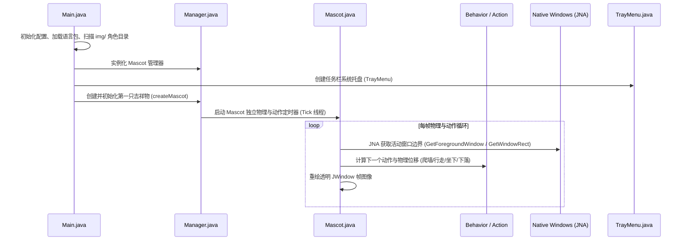

# Shimeji-ee 代码库架构与深度知识库

> 对应源码目录：`Shimeji-Desktop-DeepTutor/src/main/java/com/group_finity/mascot/`  
> 目标：基于成熟的 Shimeji 桌面交互与物理引擎，接入 DeepTutor 伴学助手（藤原妹红），提供架构体系、生命周期、动作状态机与窗口检测机制的知识索引。

---

## 一、 整体设计与启动链路

Shimeji-ee 采用 **Java (JDK 25+) + Swing + JNA (Java Native Access)** 构建。通过 JNA 直接调用 Windows 原生 API（User32/Gdi32）获取活动窗口边界，并通过纯透明浮动窗口（无边框 `JWindow`）进行高帧率、高质量像素渲染。

---

## 二、 核心源码模块与职责划分

| 源码路径 | 核心类 | 关键职责说明 | 二次开发改动关注点 |
| :--- | :--- | :--- | :--- |
| `src/.../Main.java` | `Main` | 程序主入口、环境初始化、加载行为配置与配置窗口入口 | 启动时注入 `DeepTutorClient` 并在后台建立伴学长连接 |
| `src/.../Manager.java` | `Manager` | 协调和管理桌面所有活跃 Mascot 实例、托盘联动与销毁回收 | 避免多开错乱，支持向当前主宠广播消息和控制伴学行为 |
| `src/.../Mascot.java` | `Mascot` | **核心桌宠实体**：持有透明 `JWindow`，调度物理位置、重力判定、鼠标交互（抓取、投掷） | 挂载不抢焦点跟随对话气泡 `MascotSpeechBubble`，响应妹红情绪状态 |
| `src/.../action/` | `Action`, `Move`, `Stay`, `Animate` | 具体原子动作执行器（下落、攀爬、走动、坐下、抱头） | 增加「打字」、「思考/把玩火符」、「说话/讲课」动作映射 |
| `src/.../behavior/` | `Behavior`, `UserBehavior` | 行为逻辑与转移状态机（由 XML 声明驱动） | 映射 DeepTutor 的 LLM 生成状态（如 Thinking、Streaming、Idle） |
| `src/.../environment/` | `Environment`, `WindowsEnvironment` | **JNA 窗口探测层**：检测窗口标题、工作区、任务栏坐标与 Z 轴碰撞 | 提取前台进程信息（如 `Code.exe`、`Unity.exe`）用于伴学上下文感知 |
| `src/.../image/` | `ImagePair`, `ImagePairs` | 管理左右朝向的帧图片缓冲与 DPI 自适应缩放 | 妹红动作切片（东方的妹红 Shimeji 资源包直接放置在 `img/Mokou`） |
| `src/.../TrayMenu.java` | `TrayMenu` | 任务栏托盘菜单、右键选项与全部清除逻辑 | 增加“呼叫妹红”、“伴学模式开关”、“配置 DeepTutor”菜单项 |

---

## 三、 关键底层技术与二次开发优势

### 1. 为什么 Shimeji 比 eSheep 体验好得多？
* **平滑物理调度**：Shimeji 采用基于 DeltaTime 的动画帧调度，重力加速度和下落阻尼手感极佳，绝无卡顿或慢动作。
* **干净的进程与窗体生命周期**：所有 Mascot 由统一的 `Manager` 托管，退出或右键“关闭”时，统一触发 `dispose()` 和线程终止，绝不残留幽灵窗口。
* **庞大的二次元/东方素材生态**：Shimeji 拥有全球最成熟的桌宠动画标准（46张标准帧 + `actions.xml` / `behaviors.xml`）。藤原妹红作为东方知名角色，拥有大量高精度现成动作集。

---

## 四、 DeepTutor 伴学集成槽位

1. **服务单例通信层**：在 `com.group_finity.mascot.deeptutor.DeepTutorClient` 中使用现代 Java 11+ 内置的 `java.net.http.HttpClient`，直接连接 `http://127.0.0.1:8001/api/partners/partner-e67bc7f6`，支持 HTTP POST 与 SSE 流式解析。
2. **免激活跟随气泡**：使用 Swing 的无边框 `JWindow`，重写 `getFocusableWindowState() -> false`，利用 GDI+/Java2D 绘制抗锯齿圆角半透明对话框，实时依附在 `Mascot.getAnchor()` 之上。
3. **快捷唤出与交互**：鼠标双击妹红或全局热键（通过 JNA `RegisterHotKey`）唤起极简单行输入栏。
